# PENETRATION-TESTING-REPORT
**PENETRATION TESTING REPORT**

PATIENT PORTAL & WEB APPLICATION ASSESSMENT — MEDIROZA GENERAL HOSPITAL

W4-FINAL | CYBERSECURITY | NETWORKWALKS

| **Pentester Name (Cybersecurity Professional)** | *[Kelechi Happiness Uzoma]* |
| --- | --- |
| **Program/Batch** | *[B084C Networkwalks]* |
| **Date** | *[24/11/2026]* |
| **Modules completed** | W4-PM — Web Application Black-Box Penetration Testing |
| **Client/Target** | Mediroza General Hospital (`medirozahospital.com`) — assigned training lab target, secured written permission under program scope |
| **Permission secured from client?** | Yes — assessment performed within the Networkwalks training environment |
| **Phases covered** | **Phase 1:** Reconnaissance & Footprinting **Phase 2:** WAF/Content Discovery **Phase 3:** Authentication & Injection Testing **Phase 4:** Traffic Analysis **Phase 5:** Credential/Document Security Review |

# 1. Liability Disclaimer

I have performed these activities only on the systems and targets assigned
to me within the Networkwalks training program, where written permission
was already secured as part of the program scope. All data referenced in
this report (patient records, staff information, shareholder records) is
**synthetic test data** seeded into the training environment — it does not
belong to real individuals. All materials here are for education and
research purposes only. Do not use anything from this report to break the
law. The instructor, the authors, and Networkwalks are not responsible for
what you do with this knowledge. Every action you take is your own
responsibility. Misuse can lead to criminal charges, heavy fines, loss of
employment, and a permanent record. In most countries, unauthorized access
is a crime even when nothing is damaged.

# 2. Introduction

This report covers a black-box penetration test of the Mediroza General
Hospital web application — a simulated hospital website and patient portal
used as the Week 4 capstone target for the Networkwalks Cybersecurity
internship program. The assessment moves through the full workflow: public
reconnaissance, WAF fingerprinting, content discovery, authentication/
injection testing, traffic analysis, and a review of document/credential
security on the patient portal.

All commands were run in Kali Linux. Every step below includes the exact
command used, the result observed, a screenshot as evidence, and a short
note on why the finding matters from an attacker's point of view.

# 3. Tools Used

| **Tool** | **Purpose** |
| --- | --- |
| `curl` | Read HTTP response headers and banner-grab the web server/CMS |
| `wafw00f` | Detect whether a Web Application Firewall protects the site |
| `robots.txt` / manual browsing | Content discovery of disallowed/legacy paths |
| `sqlmap` | Automated SQL injection testing against web forms |
| Manual payload testing | Manual SQL injection / auth bypass attempts |
| Burp Suite (Community) | Intercept and analyze authentication traffic |
| `pdf2john` | Extract a crackable hash from password-protected PDFs |
| John the Ripper | Offline dictionary attack against the extracted hash |

# 4. Activities Performed

## 4.1 Footprinting & Reconnaissance

I inspected the target's HTTP response headers using `curl -i`, which
identified the server stack (**LiteSpeed**) and CMS in use (**Mediroza CMS
1.4.2**, via a `generator` meta tag).

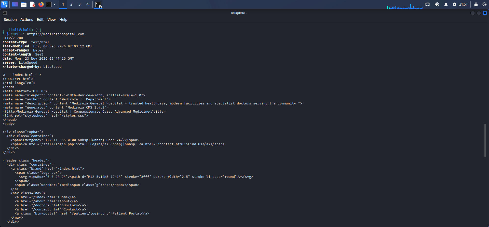

## 4.2 WAF Fingerprinting

I used **wafw00f** to check for a Web Application Firewall in front of the
site. The result identified a **LiteSpeed WAF**, which informed how the
rest of the assessment was approached (automated scanning was expected to
be rate-limited or blocked).

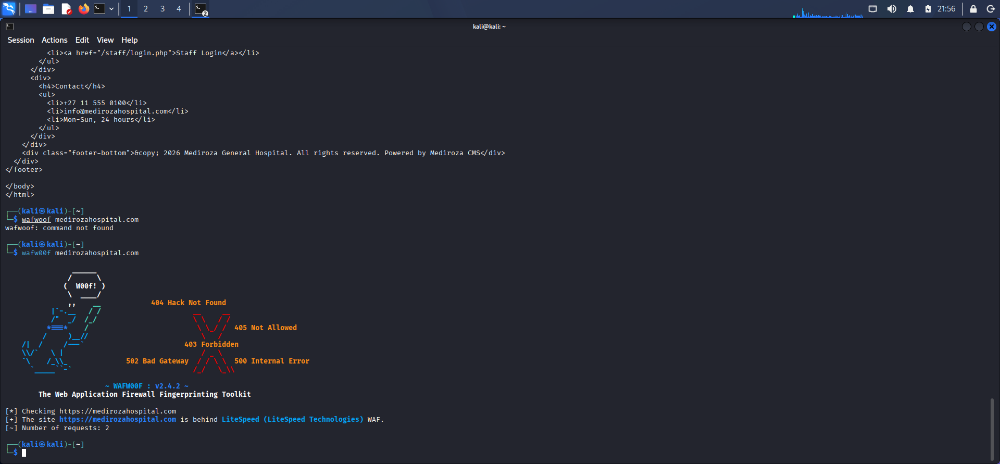

## 4.3 Content Discovery

I reviewed the site's `robots.txt`, which disclosed three disallowed
directories: `/patient/`, `/staff/`, and `/old/`. The `/old/` entry stood
out as a legacy-sounding path with no reason to still be referenced in a
production robots.txt file.

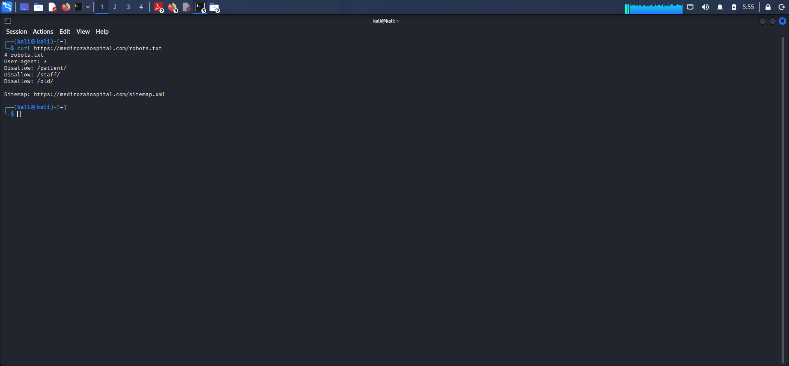

Manually browsing to `/old/` revealed an **unprotected SQL database
backup file** (`mediroza_db_backup_2019.sql`), containing a full `staff`
table (names, job titles, emails, national ID numbers, salaries) and a
`shareholders` table (names, share percentages, shares held).

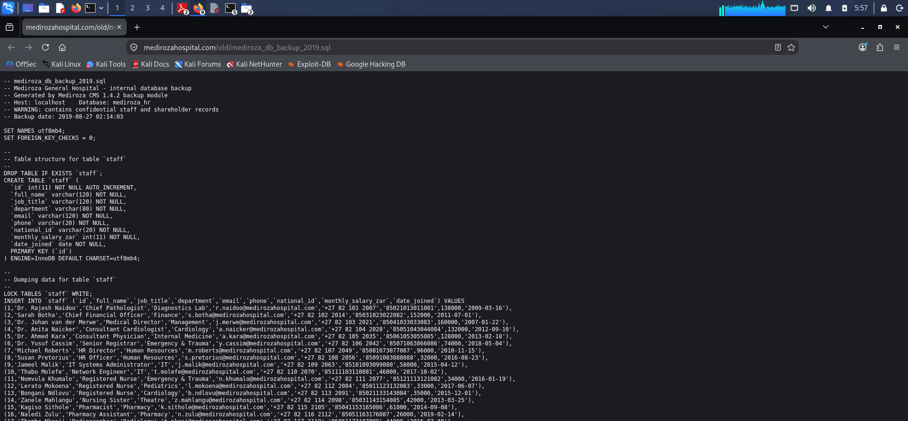
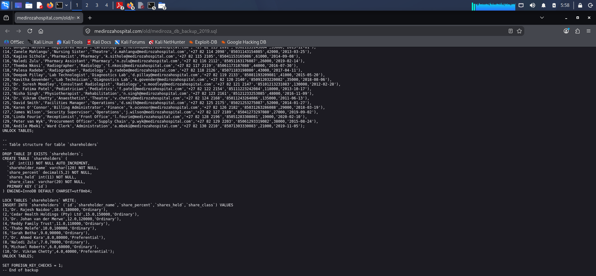

## 4.4 Authentication & Injection Testing

I tested the patient portal login form (`/patient/login.php`) manually
and with automated tooling.

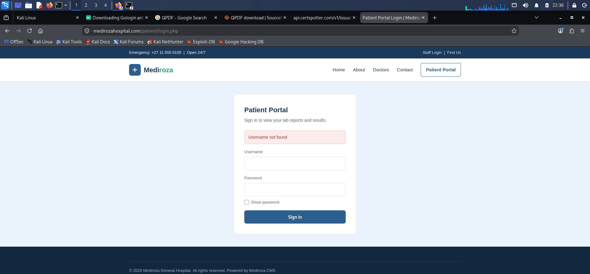

Manual payload testing (e.g. `admin'--` in the username field) did not
bypass authentication — the form consistently responded with "Username
not found."

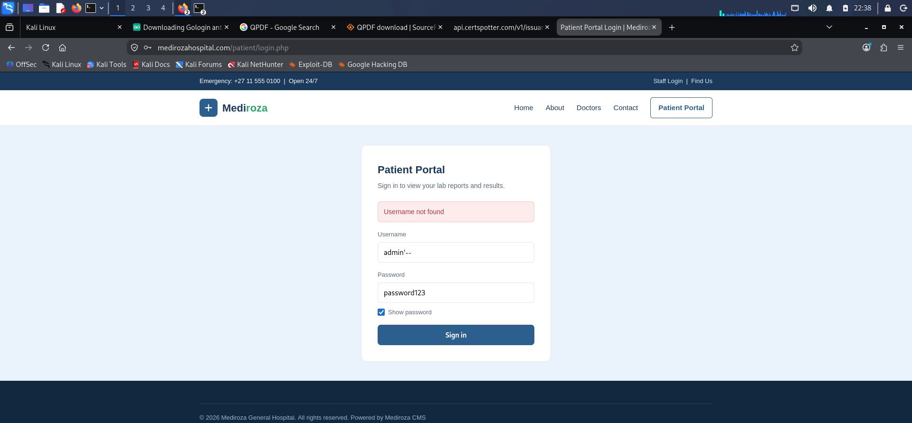

I then ran `sqlmap` in form-detection mode:
```
sqlmap -u "https://medirozahospital.com/patient/login.php" --forms --batch
```
The WAF returned HTTP 403 responses during form detection, and sqlmap
could not identify any injectable parameters.

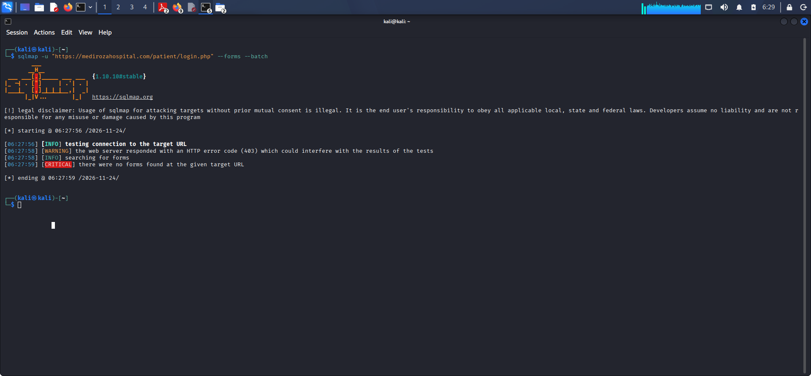

## 4.5 Traffic Analysis

I intercepted the patient portal's authentication requests using Burp
Suite to review session handling, cookie attributes, and header hygiene.

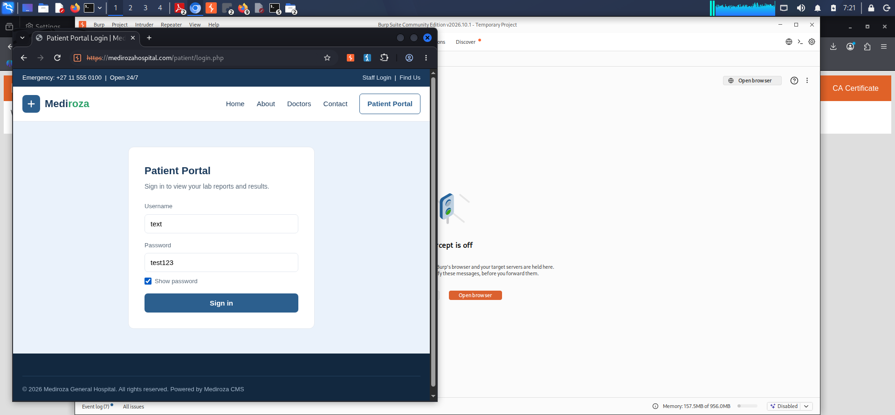
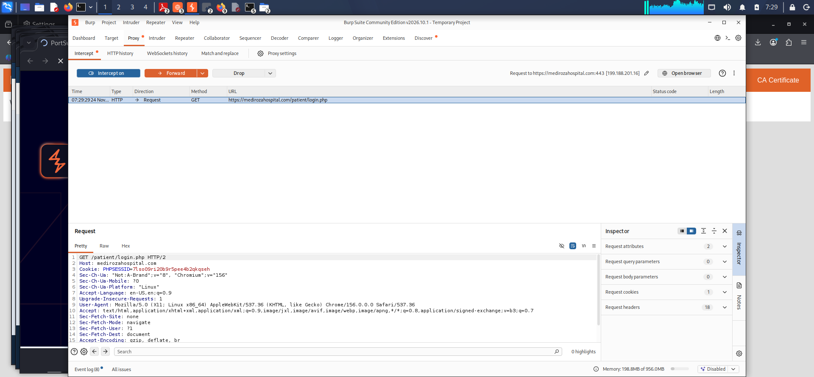

## 4.6 Credential & Document Security Review

The patient portal exposed downloadable, password-protected PDF lab
reports.

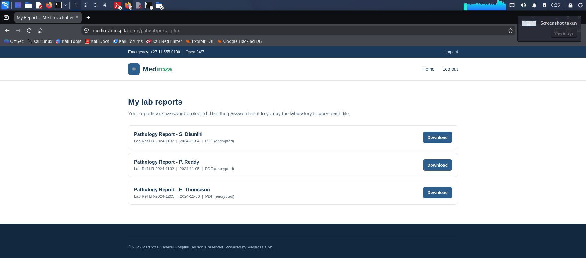

One sample report was tested for password strength using an offline
dictionary attack:
```
pdf2john patient_report_3.pdf > hash.txt
john --wordlist=/usr/share/wordlists/rockyou.txt hash.txt
```
The password was recovered in under a second against the `rockyou.txt`
wordlist, indicating a common dictionary word rather than a randomly
generated, per-document secret.

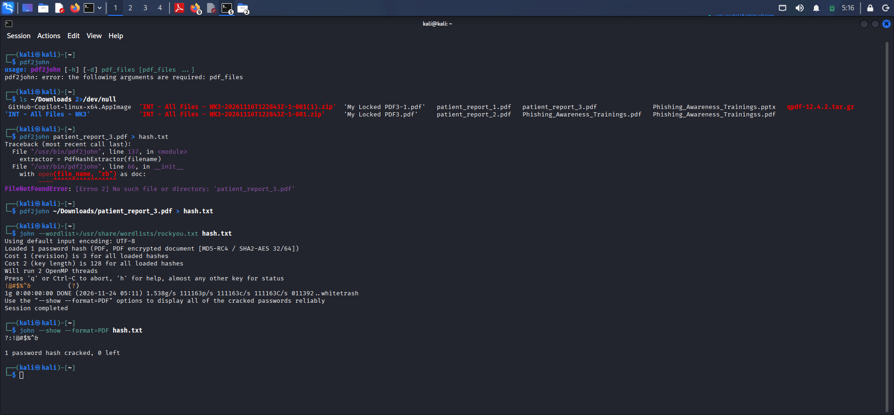

Decrypted sample reports (synthetic test data):

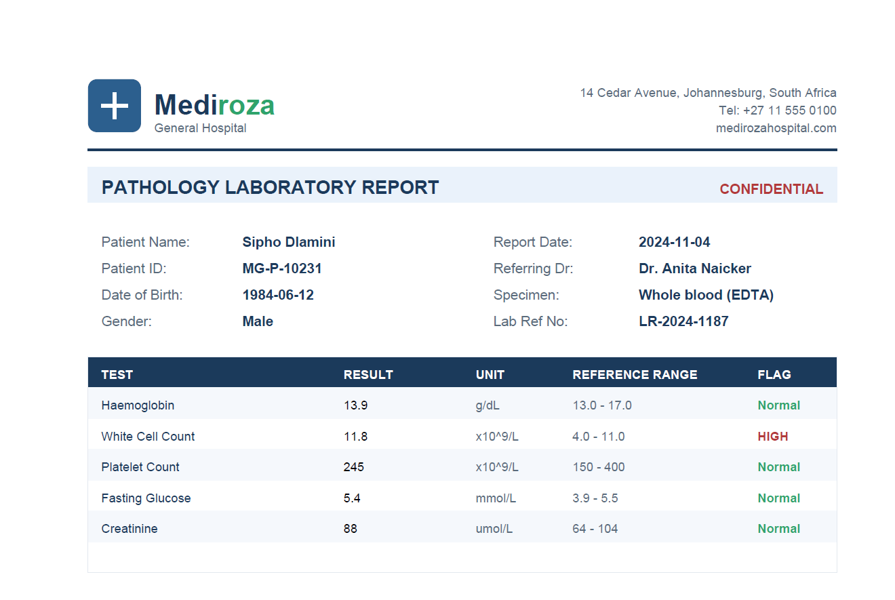
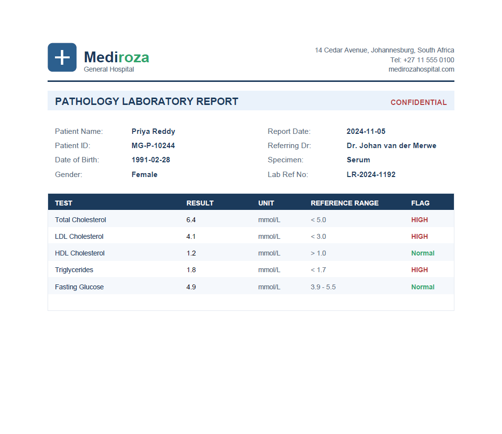
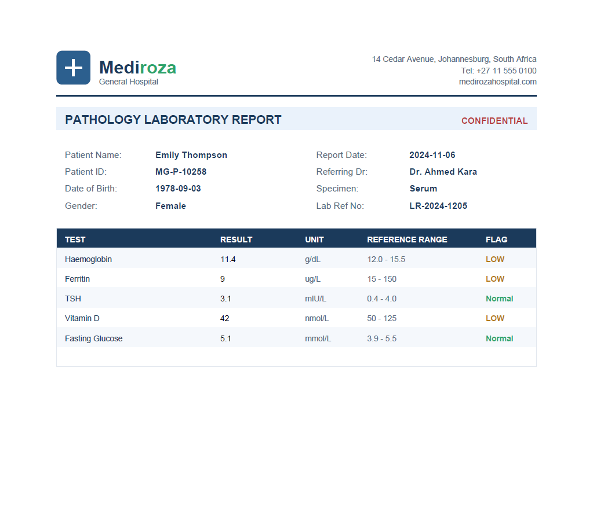

# 5. Risk Analysis / Impact

| **#** | **Risk / Finding** | **Evidence / Observation** | **Potential Impact** | **Risk Level** |
| --- | --- | --- | --- | --- |
| 1 | Legacy SQL backup file publicly accessible | `/old/mediroza_db_backup_2019.sql` reachable with no authentication, containing staff and shareholder records | Full disclosure of internal HR/financial data; a real-world breach scenario | **● Critical** |
| 2 | Weak password protecting encrypted patient reports | PDF password cracked instantly via `rockyou.txt` | Password protection offers negligible real protection if a file is obtained | **● Medium** |
| 3 | `robots.txt` discloses sensitive directory structure | `/old/`, `/patient/`, `/staff/` listed in a public file | Signals the existence of sensitive paths to any visitor, authorized or not | **● Low** |
| 4 | SQL injection — patient login form | Manual and automated testing found no injectable parameter; WAF returned 403 | No vulnerability confirmed — documented as a negative result | **● Low / Informational** |
| 5 | WAF present and actively blocking automated scans | LiteSpeed WAF identified via wafw00f, confirmed blocking sqlmap | Indicates a working protective control | **Informational** |

**Risk level key:** ● Critical ● Medium ● Low

The risks above are observations from this assessment. Where exploitation
was attempted (SQLi testing) and did not succeed, this is documented as a
negative result rather than omitted — negative results are as valuable to
report as positive findings.

# 6. Recommendations

- **Remove all backup/legacy files from the web root** entirely; store
  backups outside the webserver's public document root.
- **Enforce server-side access controls**, not `robots.txt`, on any
  sensitive directory — `robots.txt` only requests that crawlers skip a
  path, it does not restrict access.
- **Generate strong, unique, randomly-generated passwords per document**
  for any password-protected file delivered to patients, or move to
  authenticated in-portal document viewing instead.
- **Keep the WAF enabled and tuned** — it already successfully blocked
  automated SQLi scanning during this assessment.
- **Audit for similar leftover artifacts** site-wide following any CMS
  migration or backup job.
- **Periodically re-run content-discovery checks** as part of routine
  security hygiene.

# 7. Conclusion

This assessment walked through a full black-box penetration test of the
Mediroza General Hospital patient portal: reconnaissance, WAF
fingerprinting, content discovery, authentication/injection testing,
traffic analysis, and a credential security review.

The most significant finding was not the most "technical" one — a simple,
manually-checked disallowed directory (`/old/`) produced a critical data
exposure, while automated SQL injection tooling against a WAF-protected
form produced no result at all. This reinforced the importance of
manually verifying what automated tools can't reach, and reporting
negative results with the same rigor as positive ones.

These activities were completed as part of the assigned Networkwalks
Cybersecurity internship capstone project, against a designated training
environment.

# 8. Evidences Collected

All evidence referenced in Section 4 is stored in the [`evidence/`](evidence/)
folder of this repository:

| File | Description |
| --- | --- |
| `01-recon-headers.png` | HTTP header fingerprinting |
| `02-wafw00f.png` | WAF fingerprinting result |
| `03-robots-txt.png` | robots.txt content discovery |
| `04-exposed-backup-staff-table.png` | Exposed backup — staff table |
| `05-exposed-backup-shareholders-table.png` | Exposed backup — shareholders table |
| `06-patient-portal-login.png` | Patient portal login form baseline |
| `07-sqli-manual-test.png` | Manual SQLi payload test |
| `08-sqlmap-scan.png` | sqlmap automated scan result |
| `09-burp-browser-login.png` | Burp Suite browser view |
| `10-burp-intercept-request.png` | Burp Suite intercepted request |
| `11-patient-portal-reports-list.png` | Patient portal report list |
| `12-pdf2john-john-crack.png` | PDF password cracking |
| `13-15-sample-report-*.png` | Decrypted sample reports (synthetic data) |

-End-

**👤 Author**

**[Kelechi Happiness Uzoma]**
Cybersecurity Professional, [B084C]
Instructor [Waqas Karim CCIE]
LinkedIn: [https://www.linkedin.com/in/your-handle/](https://www.linkedin.com/in/your-handle/)

**📌 Project Information**

**Program Name:** Cybersecurity program at Networkwalks | **Week:** 04 | **Repository:** GitHub

Pentesting Project Report | Networkwalks | Page 1
